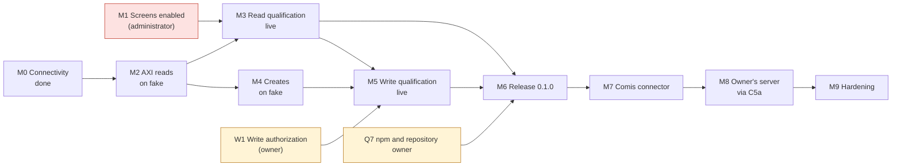
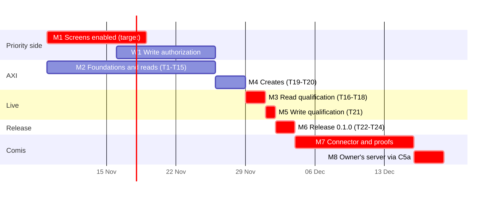

# priority-axi: master plan

|                     |                                                                              |
| ------------------- | ---------------------------------------------------------------------------- |
| Status              | Connectivity proven. **Blocked:** no Priority screen is enabled for the API. |
| Date                | 2026-11-05                                                                   |
| Design              | `priority-axi-design.md`                                                     |
| Implementation plan | `priority-axi-implementation-plan.md` (tasks T1–T24, test plan)              |
| Live test           | `test/live/priority-live.mjs`; reports in `test/live/reports/`               |

## 1. Goal

A Comis worker can read the owner's Priority ERP and propose new records. The owner approves each create. The workbench never holds the Priority password. The target is Priority 23.1 on a partner-hosted public address, and the AXI ships so that it also works on Priority Cloud and on servers inside the owner's network.

**Done means all four of these hold:**

1. `priority-live --strict` passes on QA with S1–S9 and S11, and S10 has passed once under authorization.
2. `priority-axi` 0.1.0 is on npm with signed provenance.
3. The Comis proofs in design §13 pass, and `pnpm gate` is green on the branch.
4. The owner has run a real read and one approved create through Comis.

## 2. Status board

Updated 2026-11-05 from `test/live/reports/2026-11-05T15-25-19-726Z.json` (the live run with S11) and the earlier `--sweep` run.

| Area                           | Status                                                                                                                                                                                                                                              | Evidence                                                                                                                                                                                                                             |
| ------------------------------ | --------------------------------------------------------------------------------------------------------------------------------------------------------------------------------------------------------------------------------------------------- | ------------------------------------------------------------------------------------------------------------------------------------------------------------------------------------------------------------------------------------ |
| Network and TLS to the QA host | **Done**                                                                                                                                                                                                                                            | S2: service document in 114 ms                                                                                                                                                                                                       |
| Sign-in (`API`)                | **Done**                                                                                                                                                                                                                                            | S2 200. A bad login gets 401 (S3).                                                                                                                                                                                                   |
| Priority version               | **Done**                                                                                                                                                                                                                                            | 23.1 (S4)                                                                                                                                                                                                                            |
| Company `a150125`              | **Done**                                                                                                                                                                                                                                            | S5: listed by `GETCOMPANIES` as "חברת בדיקות 15/01/25", a test company                                                                                                                                                               |
| Metadata                       | **Done**                                                                                                                                                                                                                                            | S6: 7.3 MB in 1.9 s; 1,329 screens, 35,878 fields                                                                                                                                                                                    |
| Error shapes                   | **Done**                                                                                                                                                                                                                                            | S8: the 404, not-enabled (Hebrew and English), 401 and bad-company texts are recorded                                                                                                                                                |
| Screen access (API Forms)      | **Done 2026-11-08**                                                                                                                                                                                                                                 | S7 `--sweep`: 8 of 1,328 enabled (CINVOICES, CURRENCIES, CUSTOMERS, LOGPART, ORDERS, SUPPLIERS, PORDERS, FMEC_PRDISINGLE)                                                                                                            |
| Query semantics (Q1–Q3, Q8)    | **Done 2026-11-08**                                                                                                                                                                                                                                 | S9: no `$count`; options inside `$expand` honoured; `contains` and `startswith` 501; no `GetMetadataFor`. Design §15                                                                                                                 |
| Writes                         | **Done 2026-11-08**                                                                                                                                                                                                                                 | S10 created `AXILIVE01`; `priority-axi create` created `AXILIVE02`. QA requires `WTAXNUM` (design Q9). After the administrator set up document numbering, the three W2 draft orders were created (SO26000001–SO26000003, design Q12) |
| AXI code                       | **M2, M3, M4 and M5 done**: every command (home, `screens`, `fields`, `get`, `show`, `changes`, `create`, `refresh`, `help`)                                                                                                                        | 198 tests, including the ten AXI principles against the built binary. Live `--strict`, `--deep` and `--write` pass on QA.                                                                                                            |
| Comis connector                | **Merged in Comis 2026-11-09** (`comisai/comis#3679`): the apps pack ships priority-axi 0.1.0, its read and write skills and the public-host Gate template; the catalog's owner-network `priority` entry; the AXI publisher check covers pack locks | Comis Gate tests, the `priority-orders` integration stage and the keyed `priority-plumber` row                                                                                                                                       |

## 3. Workstreams

| ID  | Workstream         | Who                                                  | Scope                                                                                          |
| --- | ------------------ | ---------------------------------------------------- | ---------------------------------------------------------------------------------------------- |
| A   | Priority side      | Owner and Priority administrator                     | API user, API Forms, transaction pool, test company, write authorization                       |
| B   | AXI build          | Developer                                            | Implementation plan T1–T15, T17, T19–T20, T22–T23                                              |
| C   | Live qualification | Developer, with the owner's authorization for writes | `priority-live` runs: T16, T18, T21, T24                                                       |
| D   | Comis connector    | Developer, with Comis reviewers                      | Design §12: C1, C2, C3, C5a, C7, C8, and the §13 proofs                                        |
| E   | Hardening          | Developer, with Comis reviewers                      | C4 updates, C6 access tokens, C2b company pinning, C5b public `--url`, a `changes`-based watch |

## 4. Milestones and gates

A milestone is done only when its gate passes. Every gate is a command or a proof.

| ID  | Milestone                                               | Stream | Depends on | Exit gate                                                                                     | Status                                                                                                                                                                                                                                                                            |
| --- | ------------------------------------------------------- | ------ | ---------- | --------------------------------------------------------------------------------------------- | --------------------------------------------------------------------------------------------------------------------------------------------------------------------------------------------------------------------------------------------------------------------------------- |
| M0  | Connectivity proven                                     | C      | —          | `priority-live`: S1–S6 and S8 pass                                                            | **Done 2026-11-05**                                                                                                                                                                                                                                                               |
| M1  | Screens enabled for the API                             | A      | —          | `priority-live --sweep`: S7 lists every screen in §7 as enabled                               | **Done 2026-11-08:** 8 screens enabled, every one in §7 among them                                                                                                                                                                                                                |
| M2  | AXI foundations and reads on the fake                   | B      | M0         | CI: unit, contract and AXI-principles tests pass (T1–T15)                                     | **Done 2026-11-05** (implementation plan §6.1)                                                                                                                                                                                                                                    |
| M3  | Read qualification on QA                                | C      | M1, M2     | `priority-live --strict` passes S1–S9 and S11 (T16–T18)                                       | **Done 2026-11-08:** `--strict` passes (10 pass, 0 fail); T17 changes made from the answers                                                                                                                                                                                       |
| M4  | Creates on the fake                                     | B      | M2         | Contract tests prove one POST per create and every answer mapped (T19–T20)                    | **Done 2026-11-05**                                                                                                                                                                                                                                                               |
| M5  | Write qualification on QA                               | C      | M3, M4, W1 | S10 passes, then one `priority-axi create` succeeds; keys and transaction cost recorded (T21) | **Done 2026-11-08:** S10 created `AXILIVE01`, `priority-axi create` created `AXILIVE02` (both with `WTAXNUM` 000000018, which QA requires); 1 transaction each; W1 2 of 5 used                                                                                                    |
| M6  | Release 0.1.0                                           | B      | M3, M5, Q7 | `npm view priority-axi` shows provenance; live S1–S11 pass on the published package (T22–T24) | **Done 2026-11-09:** the release workflow published `priority-axi@0.1.0` from tag `v0.1.0`. Its SLSA provenance names `comisai/priority-axi` and `release.yml`, and `npm audit signatures` verifies it. Live `--strict` passes on QA with the npm-installed package (S1–S9, S11). |
| M7  | Comis connector, Priority Cloud and owner-network forms | D      | M6         | Design §13 proofs pass; `pnpm gate` green; C1, C2, C3, C7 and C8 merged                       | **Done 2026-11-09** (`comisai/comis#3679`): owner-network form, skills, pack and proofs; the keyed plumber row passed on the real model under gVisor. Priority Cloud's fixed hosts remain a later form                                                                            |
| M8  | The owner's partner-hosted server in Comis              | D      | M7         | C5a: a manual `gate.yaml` template is documented, and the owner reads and creates through it  | **Template in Comis** (`images/packs/apps/templates/priority.yaml`); storing a hand-written service's secret still needs a Comis command (D3679)                                                                                                                                  |
| M9  | Hardening                                               | E      | M8         | C4, C6, C2b and C5b each have a decision record and passing proofs                            | Proposals moved to Comis (`docs/research/Priority Connector Proposals for Comis v2.md`); decision records are Comis work                                                                                                                                                          |

`M8` is on the critical path for the owner. Design §5 explains why: `comis connect` cannot reach a partner-hosted public address today, so the owner's first Comis use goes through the C5a template.

## 5. Dependencies



**Critical path:** M1 → M3 → M5 → M6 → M7 → M8.

- M2 and M4 run in parallel with the wait for the administrator.
- The project loses time only if M1 is not done by the end of week 2.

## 6. Schedule

These are estimates for one developer, starting the week of 9 November 2026. They exclude review queues in Comis.



| Milestone           | Target          | Holds if                                                                                |
| ------------------- | --------------- | --------------------------------------------------------------------------------------- |
| M1                  | by 19 Nov       | The administrator acts within two weeks of the request in §7.                           |
| M2                  | 25 Nov          | 12.5 working days of tasks.                                                             |
| M3, M4, M5          | 30 Nov to 2 Dec | M1 and W1 are done by then.                                                             |
| M6                  | 4 Dec           | Q7 is decided by the end of November.                                                   |
| M7                  | about 18 Dec    | Comis review of the `images/packs`, Gate-policy and catalog changes takes about a week. |
| M8 (owner using it) | about 23 Dec    | C5a is a documented template with no Gate code change.                                  |
| M9                  | Q1 2027         | Each item gets its own decision record.                                                 |

## 7. Owner and administrator actions (the blocker)

Ask for these in one request:

1. **API user.** Confirm `API` has an API license and only the privileges the task needs. Read access to payroll and HR screens is the main risk (design §15).
2. **API Forms.** Add these top-level screens to **Limited Access/API Forms**. Their sub-screens come with them.
   - Reads, to start: `CUSTOMERS`, `SUPPLIERS`, `LOGPART`, `ORDERS` (brings `ORDERITEMS`), `CINVOICES`, `CURRENCIES`
   - Add others as the owner's use needs them. `CURRENCIES` is small and stable, which makes it a good live-test screen.
3. **Test company.** Confirm `a150125` ("חברת בדיקות 15/01/25") is a test company where test records may be created.
4. **Write authorization (W1).** Name the screen and the most records allowed. The proposal is up to 5 records on `CUSTOMERS` in `a150125`, which costs about 5 API transactions.
5. **Transaction pool.** Confirm the monthly pool covers these, plus about 10 for later regression runs.

The administrator can check the result with `node --env-file=test/live/.env.qa test/live/priority-live.mjs --sweep`. The screens appear under `enabled:`.

**Text to send:**

> Please add these screens to Limited Access/API Forms for company a150125: CUSTOMERS, SUPPLIERS, LOGPART, ORDERS, CINVOICES, CURRENCIES. Today the API user `API` signs in, but every screen answers "API cannot be run for this form" (לא ניתן להפעיל API למסך זה). Please also confirm that `API` has an API license and only the privileges these screens need, and that a150125 is a test company where we may create up to 5 test customers.

## 8. Decisions needed

| ID       | Decision                                                      | Recommended                                                                                                                                                                                                                                                                                                                                                                                                                                                                                                                                                                                                                                                                                                                                                                                                   | Needed by      | Decides                     |
| -------- | ------------------------------------------------------------- | ------------------------------------------------------------------------------------------------------------------------------------------------------------------------------------------------------------------------------------------------------------------------------------------------------------------------------------------------------------------------------------------------------------------------------------------------------------------------------------------------------------------------------------------------------------------------------------------------------------------------------------------------------------------------------------------------------------------------------------------------------------------------------------------------------------- | -------------- | --------------------------- |
| W1       | Allow live creates on QA? Which screen and how many?          | **Decided 2026-11-05: yes, up to 5 `CUSTOMERS` records in `a150125`**                                                                                                                                                                                                                                                                                                                                                                                                                                                                                                                                                                                                                                                                                                                                         | M5             | Owner                       |
| W2       | Allow live draft sales orders on QA for the plumber workflow? | **Decided 2026-11-08: yes, up to 3 draft `ORDERS` in `a150125`, 1–2 lines each, for the customer the scenario resolves; each marked as an API test in DETAILS and its remarks; sent once.** Used 3 of 3 on 2026-11-08: SO26000001–SO26000003, all drafts                                                                                                                                                                                                                                                                                                                                                                                                                                                                                                                                                      | Plumber orders | Owner                       |
| Q7       | Who owns the npm package and the GitHub repository?           | **Repository decided 2026-11-09: `comisai/priority-axi` is public, open to contributors, with a protected `main`. It starts from a fresh history; the earlier history stays in a private archive.** npm: 0.1.0 published 2026-11-09 from GitHub Actions with provenance (M6 done). 0.2.0 published 2026-11-10. Releases now use npm trusted publishing (OIDC), and the release workflow reads no token, because npm ends direct publishing with 2FA-bypass tokens around January 2027. Before the next release, the owner adds the trusted publisher on npmjs.com (`comisai/priority-axi`, `release.yml`, environment `npm`). After the first release published that way, the owner deletes the `npm` environment's `NPM_TOKEN` secret and sets the package to disallow tokens. M7 and M8 wait for the owner. | M6             | Owner                       |
| M7-start | Start the Comis repository work before the package exists?    | **Decided 2026-11-05: not yet; 2026-11-09: yes.** The bundle moved into Comis (`comisai/comis#3679`) once 0.1.0 was on npm.                                                                                                                                                                                                                                                                                                                                                                                                                                                                                                                                                                                                                                                                                   | M7             | Owner                       |
| Q6       | Where do the username and company live?                       | In memory for v1; in the connection (C2b) when a second company or user appears                                                                                                                                                                                                                                                                                                                                                                                                                                                                                                                                                                                                                                                                                                                               | M7             | Owner and Comis maintainers |
| N1       | Error-message language                                        | Server default (Hebrew). `tabula.ini,3` breaks the Gate's named segment, and the AXI matches both languages.                                                                                                                                                                                                                                                                                                                                                                                                                                                                                                                                                                                                                                                                                                  | M2             | Developer (decided)         |
| N2       | Accept a full service root in `PRIORITY_URL`?                 | Yes. Done in the live test; F11 in the implementation plan.                                                                                                                                                                                                                                                                                                                                                                                                                                                                                                                                                                                                                                                                                                                                                   | M2             | Developer (decided)         |
| Q8       | Load one screen's metadata at a time with `GetMetadataFor`?   | Decide after M1, using S8 and S9 evidence                                                                                                                                                                                                                                                                                                                                                                                                                                                                                                                                                                                                                                                                                                                                                                     | M3             | Developer                   |

## 8.1 Runbook when the administrator enables screens

Run these in order. Each is one command.

1. **M1.** `node --env-file=test/live/.env.qa test/live/priority-live.mjs --sweep`. S7 must list the screens from §7 under `enabled`.
2. **M3, T16.** `node --env-file=test/live/.env.qa test/live/priority-live.mjs --strict`. S1–S9 and S11 must pass. S9 records the answers to Q1–Q3, and S8 records Q8.
3. **M3, T17.** Act on those answers in code: totals or "more exist", caps inside `$expand`, whether `~` works, and per-screen metadata. Re-run step 2.
4. **M5, T21, within W1.** One create, from the fixed body `test/live/create-customer.json`:

   ```sh
   PRIORITY_LIVE_WRITES=1 node --env-file=test/live/.env.qa test/live/priority-live.mjs \
     --write --write-screen CUSTOMERS --write-body test/live/create-customer.json
   ```

   Its fixed key `AXILIVE01` makes a rerun a 409, never a second record. Then one `priority-axi create CUSTOMERS --set CUSTNAME=AXILIVE02 --set 'CUSTDES=priority-axi live test (W1)' --set WTAXNUM=000000018`. That is 2 of the 5 allowed records. Record the keys and the transaction cost. _Done 2026-11-08. QA requires `WTAXNUM`, so the body carries the owner-approved placeholder `000000018`._
5. **M6.** When the owner approves publishing: add the `NPM_TOKEN` secret, set `version` to 0.1.0, and push tag `v0.1.0`. The release workflow publishes with provenance and checks the package. _Done 2026-11-09: 0.1.0, published with the `NPM_TOKEN` secret, which trusted publishing has since replaced (Q7). npm first created a placeholder version, `0.0.0-stage`, for staged publishing; 0.1.0 became `latest` about a minute later._

## 9. Live test cadence and rules

**When to run it:**

| Run                                         | Command                                          | Purpose                                                                                |
| ------------------------------------------- | ------------------------------------------------ | -------------------------------------------------------------------------------------- |
| Daily, while building                       | `priority-live`                                  | Catch server or permission drift early                                                 |
| After the administrator changes API Forms   | `priority-live --sweep`                          | See exactly what was enabled                                                           |
| At each milestone gate                      | `priority-live --strict`                         | Gate M3 and M6                                                                         |
| Before a release, or after API Forms change | `priority-live --strict --deep`                  | Run the built AXI over every enabled screen (about 300 runs, roughly 40 minutes on QA) |
| Writes, only under W1                       | `PRIORITY_LIVE_WRITES=1 priority-live --write …` | Gate M5                                                                                |
| After any Priority upgrade                  | `priority-live --sweep --strict`                 | Requalify: the version, screen names and error texts may change                        |

**Rules:**

- Run against QA only. A production read-only run needs the owner's go-ahead.
- Never run it in public CI.
- Run `--sweep` at most once a day.
- Writes are sent once and never retried.
- Archive each report. Attach the TOON summary to the pull request that closes a milestone.

## 10. Risks

| ID  | Risk                                                                                                                                    | Likelihood            | Impact                 | Mitigation                                                                                                                                              | Owner                           |
| --- | --------------------------------------------------------------------------------------------------------------------------------------- | --------------------- | ---------------------- | ------------------------------------------------------------------------------------------------------------------------------------------------------- | ------------------------------- |
| K1  | The administrator is slow to enable screens                                                                                             | High                  | High: blocks M3 onward | Build M2 and M4 against the fake now. Send one request with the exact list (§7).                                                                        | Owner                           |
| K2  | QA differs from production in version, screens or labels                                                                                | Medium                | High                   | The AXI reads all meaning from the metadata. Do a read-only live run on production before go-live.                                                      | Developer                       |
| K3  | Q1–Q3 come out badly: no `$count`, options ignored inside `$expand`, `contains` returns 501                                             | Medium                | Medium                 | The fallbacks are already designed: "more exist" with no total, client-side caps, and `~` turned off with a clear usage error.                          | Developer                       |
| K4  | The partner-hosted address cannot use `comis connect` (C5)                                                                              | Certain today         | High for the owner     | C5a manual template in M8. C5b needs a decision record in M9.                                                                                           | Developer and Comis maintainers |
| K5  | The 7.3 MB metadata exceeds the Gate's read limits (Q4)                                                                                 | Medium                | Medium                 | Measure in M7. Fallbacks: per-screen `GetMetadataFor` (Q8), or a cache built once and kept for 7 days.                                                  | Developer                       |
| K6  | Tests use up paid API transactions                                                                                                      | Low                   | Medium                 | `--dry-run`, one opt-in create, the estimate printed first, and a W1 limit of 5                                                                         | Developer                       |
| K7  | Auth probes lock the API user                                                                                                           | Low                   | High                   | The live test probes 401 with a username that cannot exist, never with the real user and a wrong password.                                              | Developer                       |
| K8  | Priority's error text changes                                                                                                           | Low                   | Medium                 | Match Hebrew and English. Unknown 400s pass through unchanged as `priority_rejected`. Live S8 catches drift.                                            | Developer                       |
| K9  | The QA password was shared in plain text in a chat session                                                                              | Already happened      | Medium                 | Keep it only in the gitignored `test/live/.env.qa`. Rotate it after M5. Use a separate production credential, held only by the Gate.                    | Owner                           |
| K10 | The AXI calls the wrong company and gets a confusing answer                                                                             | Low                   | Medium                 | `GETCOMPANIES` check, error `company_not_found` (F1–F3)                                                                                                 | Developer                       |
| K11 | An unfiltered read of a large document screen takes over a minute and hits the AXI or Gate time limit (PORDERS: 86 s on QA, design Q13) | High without a filter | Medium                 | The read skill filters every document-screen read by number, customer or supplier, or a date range (1 to 3 s on QA). Recheck ORDERS on production data. | Developer                       |

## 11. Files

| File                                       | Purpose                                                                                                                            |
| ------------------------------------------ | ---------------------------------------------------------------------------------------------------------------------------------- |
| `docs/priority-axi-design.md`              | What and why. Updated today with the QA findings.                                                                                  |
| `docs/priority-axi-implementation-plan.md` | How: layout, module contracts, tasks T1–T24, test plan, live test spec                                                             |
| `docs/priority-axi-master-plan.md`         | When and who: milestones, gates, schedule, decisions, risks                                                                        |
| `test/live/priority-live.mjs`              | The live test: read-only by default, no dependencies                                                                               |
| `test/fake/priority-fake.ts`               | Fake Priority: records, `$filter`, deep insert, Gate hold and reconnect; used by contract tests and to check the live test offline |
| `test/live/reports/*.json`                 | Reports from each run (gitignored)                                                                                                 |
